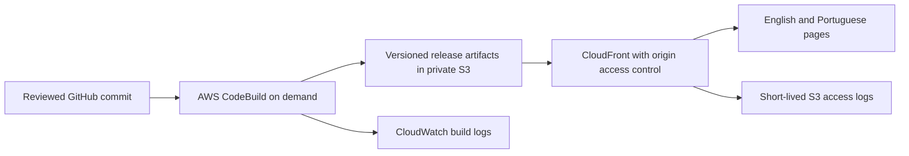

# AWS website foundation proposal

Status: proposed, October 27, 2026. Partially addresses [workspace/account/budget #6](https://github.com/danielgaio/danielgaio.com-frontend/issues/6); implementation belongs to [AWS preview #8](https://github.com/danielgaio/danielgaio.com-frontend/issues/8). This proposal is independent of the unmerged [monorepo PR #14](https://github.com/danielgaio/danielgaio.com-frontend/pull/14).

The portfolio and bilingual blog can begin as generated pages delivered from private S3 through CloudFront. Keep the API source for later features and learning; running every scaffold service continuously is unnecessary for the first preview. This leaves most of the US$10 monthly target available for experiments and unexpected usage. No resources, budgets, accounts or DNS records have been created or changed.

## Evidence and decisions still open

The available AWS identity check still returns `InvalidClientTokenId`. Account identity, organization membership, existing resources and charges are therefore unverified. The figures below estimate this proposed website's incremental usage, **not the account's total bill**. Existing costs must be included before provisioning.

Use `us-east-1` as the proposed origin/build region for this estimate; CloudFront serves viewers globally. Confirm the region after account discovery, including any residency requirements. The regional choice does not mean Brazilian visitors are charged at US edge prices. The scenario prices South America delivery.

Prefer an isolated website workload member account if an appropriate organization exists and Daniel chooses that arrangement. Keep workloads out of an organization management account. Otherwise assess a dedicated project budget and activated `Project=DanielGaioWebsite` / `Environment=preview|production|experiment` cost-allocation tags in the existing workload account. Inspect existing arrangements before creating an organization/account or expanding access. An organizational unit groups accounts; it is not itself another account. [AWS Organizations](https://docs.aws.amazon.com/organizations/latest/userguide/orgs_introduction.html)

Clarify whether AWS-only work also includes the editing environment. This proposal keeps application hosting, build, deployment and operations in AWS; it makes no new commitment to a paid remote development environment.

## Staged implementation

1. **Static preview:** first prove that the upgraded web app can export its real portfolio/blog routes. Static export does not support every server feature or the default runtime image optimizer. Generate language routes, article pages, sitemap and feed at build time; choose static image handling. Do not treat the current standalone Node build as an S3-compatible export. If runtime rendering becomes necessary, revise architecture and costs before deployment. [Next.js static export](https://nextjs.org/docs/app/guides/static-exports)
2. **Private origin and HTTPS:** use a regular S3 bucket origin with Block Public Access, SSE-S3 encryption and CloudFront OAC signing; do not use the S3 website endpoint. Scope origin reads to the distribution. Customer-managed KMS keys need separate pricing. Use managed/custom response headers for the actual application security requirements, and a tested viewer-request CloudFront Function for exported route resolution and migration redirects when needed. Preserve true 404 responses. [S3 origin access](https://docs.aws.amazon.com/AmazonCloudFront/latest/DeveloperGuide/private-content-restricting-access-to-s3.html)
3. **Release and recovery:** CodeBuild runs checks and produces an immutable release from a reviewed commit, with a deployment role scoped to the website. Build changed/released commits, not every hourly agent wakeup. Publish immutable assets before HTML, retain the previous complete release, and test restoring it. Establish the GitHub source connection through Daniel's existing authorized access; no plaintext repository token in source or logs. Add fully automatic triggers only after source access, build timing and usage controls are verified.
4. **Preview before domain cutover:** use the CloudFront preview endpoint initially. Keep current HostGator DNS and Medium routing until the content and launch tasks pass. A custom CloudFront certificate must be in `us-east-1`; use a non-exportable ACM public certificate. Verify the authoritative zone, mail/TXT records and apex/www capabilities before deciding whether DNS moves to Route 53. Registrar transfer is a separate decision. [CloudFront certificate requirements](https://docs.aws.amazon.com/AmazonCloudFront/latest/DeveloperGuide/cnames-and-https-requirements.html), [ACM pricing](https://aws.amazon.com/certificate-manager/pricing/)
5. **Operations:** retain build logs for seven days and CloudFront standard access logs in a separate private S3 log destination for seven days, with cookie logging off and a considered field set. Include log objects and request charges in the storage/request envelope. Use plain-text delivery rather than paid format conversion. Verify delivery and retention rather than assuming that enabling logging is sufficient. Start with standard service metrics and one alarm; add paid dashboards, custom metrics or synthetic monitors only with a revised estimate. [Standard logging and delivery costs](https://docs.aws.amazon.com/AmazonCloudFront/latest/DeveloperGuide/standard-logging.html)

The NestJS/Prisma scaffold is not an implemented publishing system. The initial public site needs no running database/API. Keep future interactive features independently deployable; choose their actual data model and serverless/container runtime in a separate measured slice. This proposal does not imply that the existing Prisma data layer works with DynamoDB.

## Monthly usage scenario, excluding credits and Free Tier

Prices checked October 27, 2026. The companion [cost-scenario.json](cost-scenario.json) records quantities, exact rates, source URLs and catalog rate identifiers. All quantities are assumptions to measure during preview, not a traffic forecast or an enforced quota. Storage includes release versions, assets, build artifacts and access logs.

| Component | Assumed monthly quantity × unit price | USD |
| --- | --- | ---: |
| S3 Standard, us-east-1 | 5 GB-month × 0.023 | 0.115 |
| S3 PUT/COPY/POST/LIST | 10,000 × 0.005 / 1,000 | 0.050 |
| S3 GET / Tier2 | 20,000 × 0.0004 / 1,000 | 0.008 |
| CloudFront South America transfer | 10 GB × 0.110 | 1.100 |
| CloudFront South America HTTPS | 100,000 × 0.022 / 10,000 | 0.220 |
| CloudFront Function | 100,000 × 0.10 / 1,000,000 | 0.010 |
| CloudFront invalidation paths | 10 × 0.005 | 0.050 |
| CodeBuild Linux x86 small | 100 build minutes × 0.005 | 0.500 |
| CloudWatch build log ingestion | 0.1 GB × 0.50 | 0.050 |
| CloudWatch log storage | 0.1 GB-month × 0.03 | 0.003 |
| One standard alarm metric | 1 month × 0.10 | 0.100 |
| Optional Route 53 zone | 1 zone-month × 0.50 | 0.500 |
| Optional non-alias standard DNS | 100,000 × 0.40 / 1,000,000 | 0.040 |
| **Conservative subtotal including optional DNS** | | **2.746 ≈ 2.75** |

Without the optional Route 53 lines, the preview scenario is **US$2.206 ≈ US$2.21**. CloudFront ALIAS A/AAAA queries are not charged; the DNS query line deliberately allows other records and misses. Zone fees are not prorated. Sources: [S3](https://aws.amazon.com/s3/pricing/), [CloudFront PAYG](https://aws.amazon.com/cloudfront/pricing/pay-as-you-go/), [CodeBuild](https://aws.amazon.com/codebuild/pricing/), [CloudWatch](https://aws.amazon.com/cloudwatch/pricing/), [Route 53](https://aws.amazon.com/route53/pricing/).

Small build compute suitability is unverified. At the same 100 minutes on Linux medium (US$0.010/minute), the subtotal becomes **US$3.246 ≈ US$3.25**. Include provisioning, dependency installation, failed attempts and rounding to whole minutes. Hourly five-minute small builds would consume **720 × 5 × 0.005 = US$18** in a 30-day month before other services. Use changed-commit triggers/manual builds, concurrency one, a 15-minute timeout and a measured monthly build allowance; re-estimate after the first build rather than retrying indefinitely.

Plan for roughly **US$3 recurring + US$3 bounded learning + US$4 headroom** only after current charges are known. The headroom must absorb differences in usage, viewer geography, taxes and incidental operations. Another 10 GB of South America delivery adds US$1.10 before allowances. This is not an upper bound: public requests, storage and retries can exceed assumptions. Existing account charges, taxes/currency conversion, domain registration, Medium and Codex are outside this incremental table. No paid API/database, CodePipeline, reserved build fleet, remote image server or additional security product is included; price any addition before enabling it.

### CloudFront flat-rate alternative

AWS also lists a **US$0 Free flat-rate plan**, with 1M requests, 100 GB transfer, five WAF rules and 5 GB S3 storage credits. It is distinct from PAYG Free Tier. Verify account-plan/historical-usage eligibility, attached DNS coverage, feature support and infrastructure automation before selection. The Free tier's feature table excludes logging and custom caching rules; do not assume the broad marketing list applies to every tier. Paid Pro is US$15/month, already above this project's target. Origin requests, builds and services outside the bundle still need pricing. Keep the PAYG estimate as a fallback and do not spend anticipated credits. [Plan pricing](https://aws.amazon.com/cloudfront/pricing/), [features, eligibility and allowances](https://docs.aws.amazon.com/AmazonCloudFront/latest/DeveloperGuide/flat-rate-pricing-plan.html)

## Budget, first exercise and implementation gate

After authenticated account/resource/cost discovery, configure and verify a US$10 monthly website budget covering production **and** experiments. Scope it to the actual workload account or activated project tags, and check for untagged/shared charges. Suggested actual-spend alerts are US$5, US$8 and US$10, plus a forecast alert when supported by sufficient history. Confirm Daniel's recipient through the account; no notification address is inferred from earlier speech. Budget monitoring/notifications are free, but emailed budget reports and some action configurations can cost extra. Alerts update with delays and cannot guarantee a US$10 cutoff. [Budgets pricing](https://aws.amazon.com/aws-cost-management/aws-budgets/pricing/), [Budgets behavior](https://docs.aws.amazon.com/cost-management/latest/userguide/budgets-best-practices.html)

First exercise: use an isolated preview release to demonstrate **private-origin denial, cache behavior and rollback**. Record the release/commit identifier; show direct S3 access denied while the CloudFront page succeeds; compare cache hits/misses; publish and then restore a deliberate visible preview change; verify deep links and a real 404. Bound it to one hour, two builds totaling at most 30 small-build minutes, 1 GB viewer delivery and 1,000 requests. With two invalidation paths, the modeled compute/delivery/function/invalidation charges are approximately US$0.273 before small storage/log/request costs; reserve **US$1** from the learning envelope, re-estimate if build compute differs, and count all actual usage in the total budget. No synthetic load run is part of this exercise. Use versioned assets and at most two targeted invalidation paths; the estimate applies the paid rate without assuming an available allowance.

Teardown verification: disable any exercise trigger, stop running builds, remove only exercise resources and all temporary object versions/delete markers, expire temporary logs, and list remaining resources by experiment identity. Preserve production and the previous recoverable release. Reconcile delayed cost data on the next check; absence of a CloudFormation stack alone does not prove storage/log cleanup.

The next implementation slice under #8 is to validate static export and implement TypeScript infrastructure for a private-origin preview with reproducible release/rollback. Before deploying: establish usable AWS sign-in and identity; inventory organization/current costs; choose separation/region; verify budget/recipient; and measure the actual build. Before production: additionally complete portfolio facts/languages, dependency review, Medium asset/URL reconciliation, TLS/DNS recovery and representative browser checks. Keep #6 open until its authenticated acceptance conditions pass.
